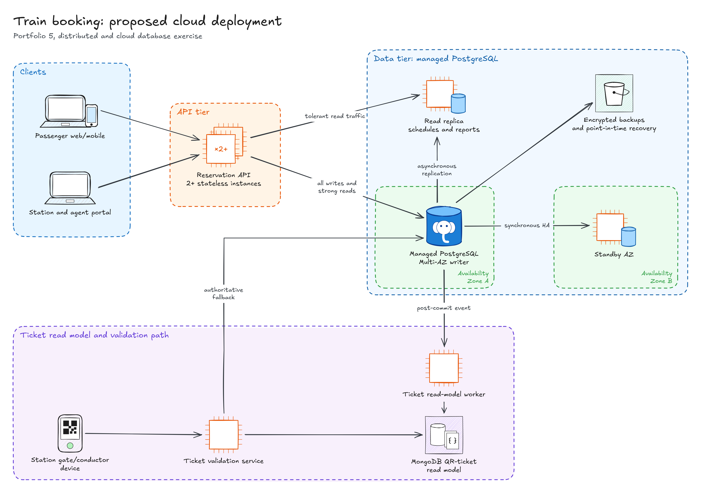

# advanced-database-systems-portfolio
A case study of the Nigerian Railway Corporation (NRC) e-ticketing database using PostgreSQL, MongoDB and advanced database concepts
```
Organization: Nigerian Railway Corporation

System: Passenger Train E-Ticketing and Seat Reservation Platform
```
### Case study and system scope

This individual portfolio models a passenger e-ticketing and train-reservation system for the Nigerian Railway Corporation (NRC). Public NRC information shows multiple passenger services and approved booking portals. The proposed system supports passengers, ticket agents, station staff, conductors and administrators. It stores user accounts, stations, routes, ordered route stations, trains, coaches, seats, dated journeys, journey stops, bookings, booking passengers, tickets, payments and fares. All passenger details, identifiers, journey dates, fares and payment records used in the implementation are synthetic.

The main operations are journey search, origin and destination selection, coach and seat selection, passenger registration, payment, QR-ticket issuance, booking-history lookup, ticket validation and operational reporting. Freight logistics, train maintenance, signalling, crew rostering and payroll are outside the passenger-reservation boundary.

### distributed cloud architecture



## Portfolio activities and results

### Portfolio 1 - Database design and modelling

I implemented fourteen PostgreSQL tables in the default `public` schema: `users`, `stations`, `routes`, `route_stations`, `trains`, `coaches`, `seats`, `journeys`, `journey_stops`, `bookings`, `booking_passengers`, `tickets`, `payments` and `fares`. The model is normalized to Third Normal Form so that users, physical railway assets, journey schedules, bookings and financial records are stored independently and connected through keys.

Primary keys identify every row, while unique constraints protect business identifiers such as email, station code, route code, train number, booking reference, ticket number, QR token and payment-provider reference. Foreign keys preserve relationships between routes and stations, trains and coaches, bookings and passengers, and tickets and journeys. Composite constraints ensure that the passenger referenced by a ticket belongs to the same booking and that its boarding and destination stops belong to the selected journey.

A train seat differs from a flight seat because it can be sold again after a passenger alights. Each ticket therefore stores boarding and alighting sequences and a generated integer range representing the occupied journey segment. A GiST exclusion constraint rejects overlapping `HELD`, `ISSUED` or `USED` tickets for the same journey and seat. It still permits adjacent reservations such as Lagos-Abeokuta `[1,2)` followed by Abeokuta-Ibadan `[2,3)`.

**Evidence:** [design, schema and ER diagram](./portfolio-1-database-design/Abetang_Abetang_301917898_ER_Diagram.png)

### Portfolio 2 - Query processing and optimisation

The relational query workload includes journey search, booking itinerary retrieval, segment occupancy, revenue by route, payment reconciliation and popular station-pair analysis. I generated 16,000 synthetic journeys and used `EXPLAIN (ANALYZE, BUFFERS)` to measure a scheduled-journey search for route 1 between 1 March and 1 April 2028. I ran the same query three times before and after creating the composite index `idx_journeys_route_departure` on `(route_id, planned_departure)` and used the median measurements.

| Measurement | Before portfolio index | After portfolio index |
|---|---:|---:|
| Index used | `uq_dated_service` | `idx_journeys_route_departure` |
| Median execution time | 1.860 ms | 1.886 ms |
| Median planning time | 1.144 ms | 0.222 ms |
| Shared buffers hit/read | 75/0 | 46/0 |
| Rows produced by index scan | 2,976 | 744 |
| Rows removed by filtering | 2,232 | 0 |
| Index searches | 9 | 1 |
| Estimated upper plan cost | 387.11 | 292.00 |

The execution time remained effectively unchanged because the dataset was small and already cached in memory. However, the new index produced a more selective access path: buffer hits fell by approximately 38.7%, the index returned only the 744 required candidates, and the estimated upper plan cost fell by approximately 24.6%. This demonstrates that index value should be assessed using the entire plan and resource usage rather than timing alone. The trade-offs are additional storage and maintenance work during inserts and updates.

**Evidence:** [Index queries](./portfolio-2-query-optimisation/Abetang_Abetang_301917898_Performance03_CreateIndexes.sql) and [measured performance comparison](./portfolio-2-query-optimisation/Abetang_Abetang_301917898_PerformanceComparison.md)

### Portfolio 3 - Transactions and concurrency

The transaction exercise demonstrates atomicity, consistency, isolation and durability in the booking workflow. A serializable transaction creates a booking, booking passenger, successful payment and ticket before changing the booking status to `CONFIRMED`. These changes commit together. A separate rollback demonstration inserts a temporary booking inside a transaction, shows that it is visible within the transaction, rolls it back and confirms that zero rows remain.

For the two-session concurrency test, Session A inserted an active ticket for journey 1, seat 3 and occupied range `[1,3)`. Session B attempted to issue the same seat for overlapping range `[1,2)`. PostgreSQL rejected Session B with SQL state `23P01` and the exclusion constraint `ex_no_overlapping_seat_ticket`. This proved that the database prevents a double sale even if separate application sessions attempt conflicting bookings at nearly the same time.

**Evidence:** [transaction](./portfolio-3-transactions-concurrency/Abetang_Abetang_301917898_BookingCommit.sql) and [concurrency scripts](./portfolio-3-transactions-concurrency/Abetang_Abetang_301917898_ConcurrencySessionA_03.png)

### Portfolio 4 - NoSQL and advanced data models

I implemented a MongoDB document model in MongoDB Atlas. The `nrc_ticket_read` database contains one `ticket_documents` collection with three synthetic tickets. Each document is a denormalized ticket snapshot containing the booking reference, masked passenger identity, journey, boarding and destination stations, coach, seat, fare, QR token, status, validation summary and synchronization metadata.

This model is suitable because a gate, conductor or customer normally retrieves and displays a complete ticket as one unit. Embedding avoids joins across several relational tables. A unique `qr_token` index supports direct QR lookup, while a `booking_reference` index supports booking history; two documents share `NRC0001` to demonstrate a multi-ticket booking. JSON Schema validation enforces required fields, and an execution plan demonstrates the QR index.

MongoDB does not replace the transactional database. Embedded data is duplicated and the Atlas read model may be briefly out of date. PostgreSQL therefore remains authoritative for payments, bookings and concurrency-safe seat allocation. MongoDB is updated only after the PostgreSQL transaction commits.

**Evidence:** [implementation and suitability](./portfolio-4-nosql/Abetang_Abetang_301917898_README.md) 

### Portfolio 5 - Distributed and cloud database exercise

The proposed production deployment uses managed PostgreSQL with a Multi-AZ standby, encrypted backups and point-in-time recovery. An asynchronous read replica serves timetable searches, booking-history reads and reporting workloads that can tolerate short replication lag. All payment, booking and seat-allocation writes go to the primary writer. A post-commit worker updates the MongoDB Atlas ticket read model using idempotent upserts.

The design prioritizes consistency for seat allocation. During a network partition, the system should reject or queue a seat-changing operation rather than risk issuing overlapping tickets. Timetable searches, reports and ticket display may use eventual consistency because a short delay is less harmful than a double booking. Signed QR tokens could support limited offline validation at stations, but revocation and last-minute changes would still require an authoritative online check.

Sharding is not initially required. Appropriate indexes, connection pooling, archival or partitioning by journey date, and read replicas should be used first. If later scale requires distribution, all tickets and seat-conflict checks for one journey must remain together. The portfolio provides an architecture and verification query but does not claim that a managed PostgreSQL cloud deployment was executed.

**Evidence:** [5 distributed and cloud design](./portfolio-5-distributed-cloud/Abetang_Abetang_301917898_README.md) 

## 3. Individual technical reflection

The most important design decision I made was representing seat occupancy as a journey segment rather than placing only a unique constraint on journey and seat. A simple unique key would stop the same seat from being sold again after a passenger leaves the train. The generated range and exclusion constraint model the railway rule more accurately while still preventing overlapping reservations.

I also learned that adding an index does not automatically make every execution faster. My one-month test showed almost identical execution times, but the composite index reduced candidate rows, filtering, buffer activity and estimated cost. A second wider-range experiment returned about one quarter of the table and showed that a sequential scan could be competitive because the indexed plan still visited almost every heap page. This improved my understanding of selectivity and why optimisation must be measured rather than assumed.

During implementation, I encountered `psql` commands such as `\gset` failing in pgAdmin and `load()` being unsupported in the Compass embedded shell. I corrected the PostgreSQL scripts to use ordinary SQL and executed the MongoDB script through an Atlas-compatible workflow. If extending the project, I would automate PostgreSQL-to-MongoDB synchronization, test recovery from failed events, increase the performance dataset and repeat the concurrency test under a controlled load.

## 4. References

1. Nigerian Railway Corporation, [Train Schedules](https://nrc.gov.ng/schedules/).
2. MongoDB, [Data Modeling Best Practices](https://www.mongodb.com/docs/current/data-modeling/concepts/embedding-vs-references/).
3. Amazon Web Services, [Working with Read Replicas for Amazon RDS for PostgreSQL](https://docs.aws.amazon.com/AmazonRDS/latest/UserGuide/USER_PostgreSQL.Replication.ReadReplicas.html).

## 5. AI-use declaration

I used OpenAI Codex to help interpret the assignment requirements, research public documentation, propose the initial database structure, draft SQL and MongoDB scripts, explain database concepts, troubleshoot execution errors and organize the repository. I personally created and queried the PostgreSQL and MongoDB Atlas databases, ran the schema, seed, query, indexing, transaction, rollback and concurrency exercises, captured the submitted evidence, reviewed the measured execution plans and corrected the implementation for the tools I used. I understand the submitted design and remain responsible for its correctness, originality and explanation.
