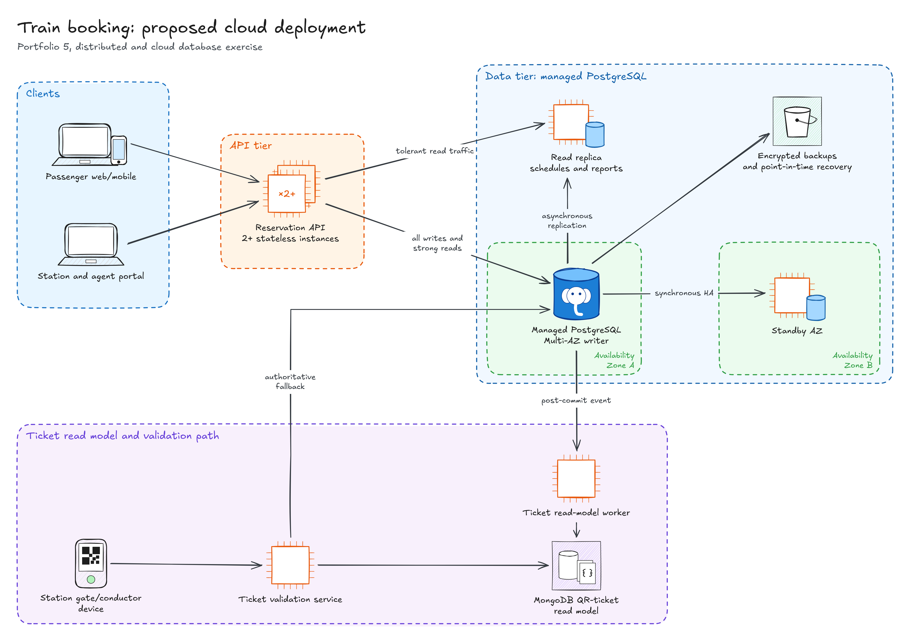

# Portfolio 5 - Distributed and Cloud Database Exercise

## Proposed deployment

## Availability and replication

- A Multi-AZ standby supports failover if the writer or its availability zone fails.
- An asynchronous read replica serves timetable searches, booking history and reports that can tolerate short replication lag.
- Booking confirmation, successful-payment state and seat allocation always use the writer.
- Automated backups, point-in-time recovery and tested restores protect against deletion or corruption.
- Suggested exercise objectives are an RPO of five minutes and an RTO of thirty minutes; production targets require formal NRC/provider business analysis.

## Consistency decision

Seat allocation prioritizes consistency. During a network partition, the service should reject or queue a seat-changing request rather than issue overlapping tickets. Timetable searches and MongoDB ticket displays may be eventually consistent because a short delay is less harmful than double-selling a seat.

The MongoDB read model is written only after the PostgreSQL transaction commits. Idempotent upserts by ticket number and `source_version` make duplicate event delivery safe.

## Station connectivity

Station and conductor devices may temporarily lose connectivity. A production QR design can use a signed token containing only the minimum ticket claims and expiry, allowing limited offline verification. Devices should later upload validation events. Revocations and last-minute changes still require online checks, so offline acceptance must follow a documented risk policy.

## Scaling and sharding

Sharding is not initially required. First use correct indexes, connection pooling, partition old tickets by journey date and add read replicas. If one writer eventually becomes insufficient, route/service region and journey date are possible boundaries. All tickets and seat-conflict checks for one journey must remain together so the exclusion rule is local.

## Security

- Private database networking and TLS
- Encryption at rest and managed secrets
- Least-privilege application, reporting and migration roles
- Tokenized identity references instead of plaintext NIN values
- Audit logs for privileged access and financial changes
- Masked or synthetic development data
- Backup, replica-lag, storage and failed-payment monitoring

`cloud_verification.sql` reports whether the connected PostgreSQL node is a writer/replica and shows replication information available to the current role.

Reference: [AWS - RDS for PostgreSQL Read Replicas](https://docs.aws.amazon.com/AmazonRDS/latest/UserGuide/USER_PostgreSQL.Replication.ReadReplicas.html).

